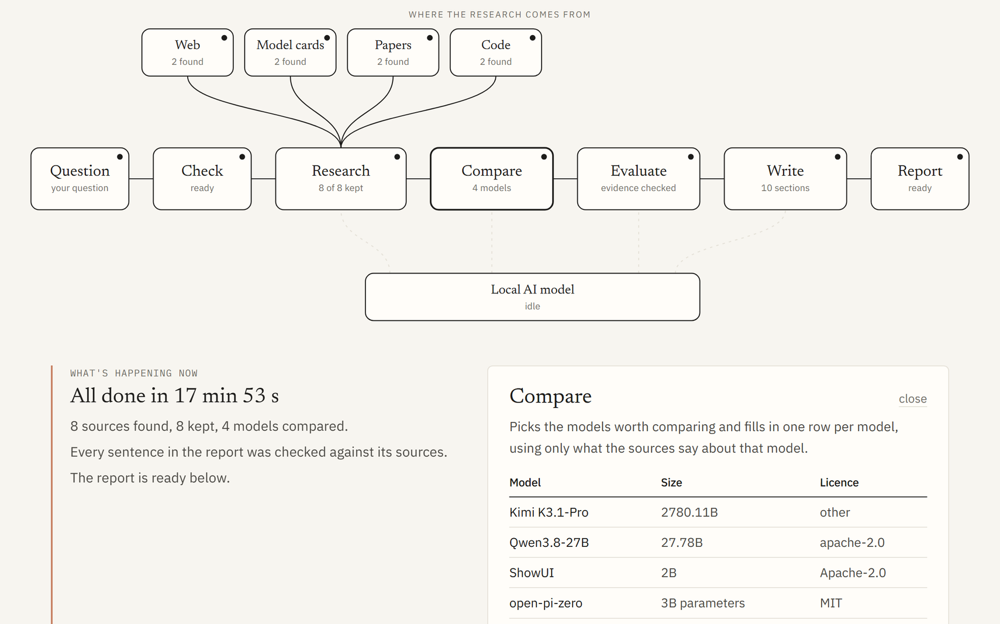
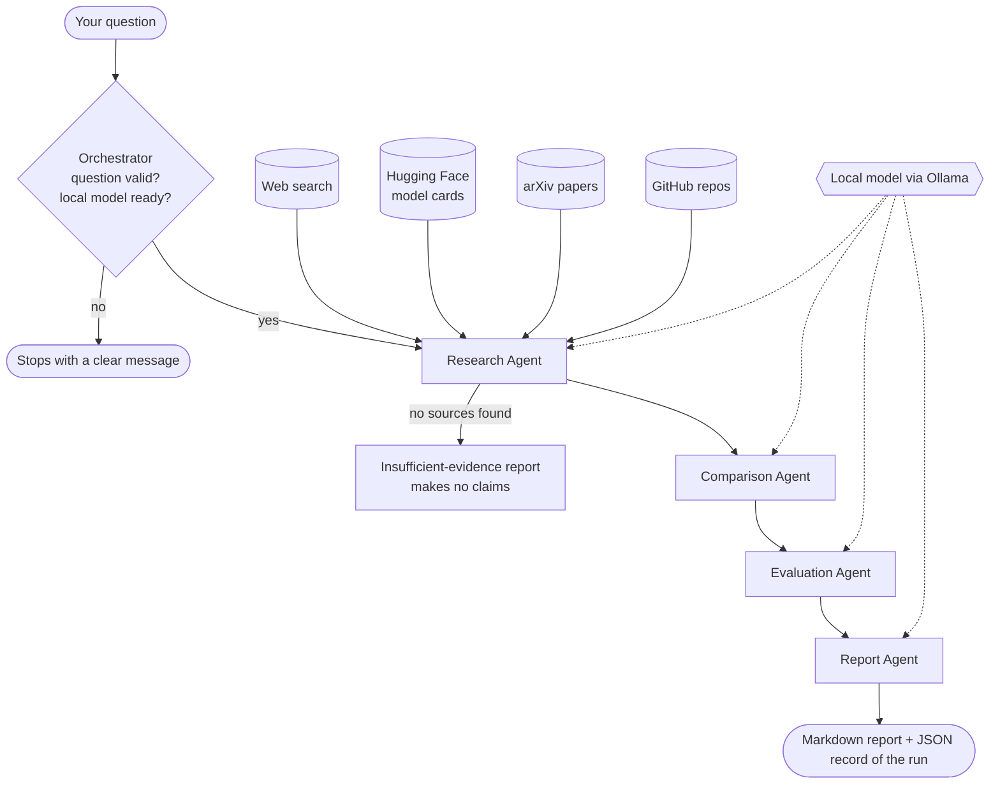

# Multi-Agent AI Research Assistant

**[▶ Live demo](https://research-agents-blush.vercel.app/)** (replays a real run, step by step) ·
**[→ Full documentation](multi-agent-research-assistant/README.md)**

Ask it something like:

> *"Research the latest open-source multimodal models suitable for on-premise deployment. Compare their
> capabilities, benchmarks, hardware requirements, licensing and limitations."*

Four agents get to work. Eighteen minutes later, on a laptop with no GPU and no paid AI service, you
have a 10-section research report with sources. Every link in it was actually opened, and no benchmark
score appears in it unless the source really says it.

[](https://research-agents-blush.vercel.app/)
<sub>The live demo at the end of the example run. On the site you can click any box to see what that step found.</sub>

## What happens when you press Start

These are the real numbers from the [example run](multi-agent-research-assistant/outputs/example_report.md).

**1. A quick check.** Before anything else, the orchestrator makes sure the question makes sense and the
local model is loaded. If Ollama isn't running, the run stops here with a message telling you how to fix
it, instead of failing ten minutes in.

**2. Research (about 9 min).** The model turns the question into search terms. Code then searches four
places: the web, Hugging Face model cards, arXiv and GitHub. It found 8 sources and numbered them S1 to
S8, and the model read each one and wrote down the facts. From this point on, the model can only refer to
a source by its number. It never writes a URL itself.

**3. Compare (about 3 min).** It picked 4 models (Kimi K3.1-Pro, Qwen3.8-27B, ShowUI, open-pi-zero) and
filled the table one row at a time, each from only the lines about that model. Licences and parameter
counts come straight from the Hugging Face and GitHub APIs, not from the model's memory.

**4. Evaluate (about 3 min).** A benchmark score is kept only if the number and the benchmark name are
really in the cited source. In this run none passed, and the report says so instead of inventing some.
It also works out memory needs: Qwen3.8-27B needs about 16.7 GB at 4-bit (a single-GPU option), while
Kimi K3.1-Pro, at 2.78 trillion parameters, needs about 1.7 TB.

**5. Write (about 3 min).** The model writes the report. Before it is saved, code removes any citation to
a source that doesn't exist, and any sentence that cites a source which never mentions the model it is
talking about. The reference list is built by code, so every link in it is real.

## The workflow



The agents are wired together with **LangGraph** and share one typed state. The model does the language
work (choosing search terms, reading, filling in rows, writing). Code does everything that has to be
exact: calling the search tools, URLs, citations, licence categories, benchmark checks and arithmetic.

## Things that went wrong along the way

Nine full runs with the real model exposed problems the unit tests never could. A few of them:

* The first version asked the 2B model to build the whole comparison table in one go. It returned an
  **empty table**. Splitting the job into one small call per model fixed it.
* The word "on-premise" in a search matched an arXiv paper about "**premise**-induced hallucination".
  Generic words like that are now stripped before searching.
* "Kimi K3" quietly inherited **Kimi K3.1-Pro's 2.78 trillion parameters**. Name matching now respects
  version numbers.
* A **price** (`$0.07/1M tokens`) ended up in the licence column. Values that look like prices are now rejected.

Each fix has a regression test. The full list is in
[the README, section 9](multi-agent-research-assistant/README.md#what-live-testing-changed-9-full-runs),
along with the flaws still in the example report, which I left in on purpose.

## Links

| | |
|---|---|
| Live demo | [research-agents-blush.vercel.app](https://research-agents-blush.vercel.app/) |
| Example report (real run, unedited) | [`outputs/example_report.md`](multi-agent-research-assistant/outputs/example_report.md) |
| Original brief | [`docs/PROJECT_BRIEF.md`](multi-agent-research-assistant/docs/PROJECT_BRIEF.md) |
| Architecture | [README, section 2](multi-agent-research-assistant/README.md#2-architecture) |
| How hallucinations are contained | [README, section 3](multi-agent-research-assistant/README.md#3-how-hallucinations-are-contained) |
| Tests (139 passed, offline) | [`docs/test_results.txt`](multi-agent-research-assistant/docs/test_results.txt) |

**Stack:** Python 3.11+, LangGraph, Ollama (`qwen3.5:4b` by default), Pydantic, Streamlit,
DuckDuckGo search, Hugging Face Hub API, arXiv API, GitHub REST API, Requests + BeautifulSoup,
FastAPI, and Next.js for the demo page.

## Quick start

```bash
cd multi-agent-research-assistant
python -m venv .venv
# Windows: .venv\Scripts\activate      macOS/Linux: source .venv/bin/activate
pip install -r requirements.txt
ollama pull qwen3.5:4b            # or qwen3.5:2b on machines with less than 6 GB free RAM
cp .env.example .env              # Windows: copy .env.example .env
streamlit run app.py
```

Setup details, the demo page, tests and limitations are in the
[project README](multi-agent-research-assistant/README.md).
