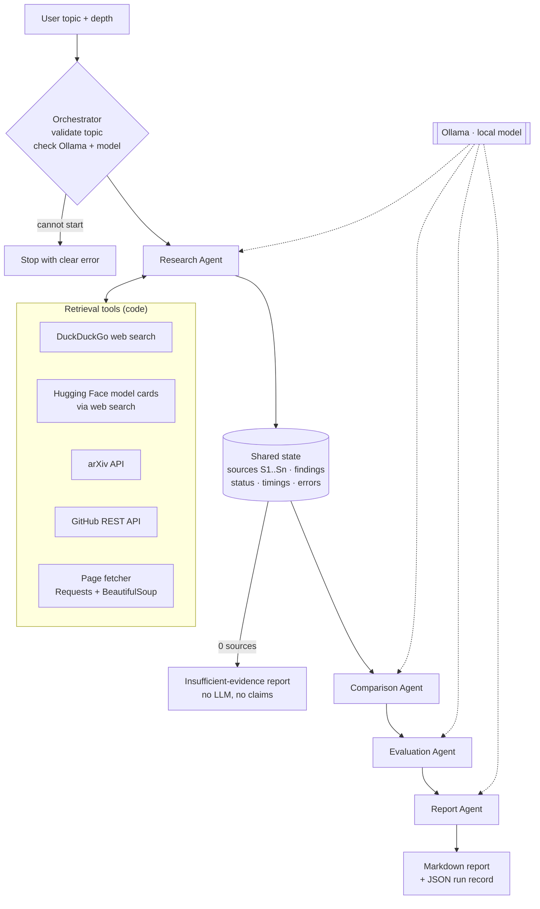

# Multi-Agent AI Research Assistant

A proof-of-concept **AI research team**: four specialised agents, coordinated by a LangGraph
workflow, investigate a technical topic and produce a structured, cited Markdown report.
All LLM inference runs **locally through Ollama** — no paid APIs, no API keys required.

> Example query: *"Research the latest open-source multimodal models suitable for on-premise
> deployment. Compare their capabilities, benchmarks, hardware requirements, licensing and limitations."*
> → see the generated example in [`outputs/example_report.md`](outputs/example_report.md).

---

## 1. What it does

| Agent | Responsibility | Output (Pydantic schema) |
|---|---|---|
| **Research Agent** | Plans search queries; searches the web (DuckDuckGo), Hugging Face model cards, arXiv and GitHub; fetches pages; extracts findings per source | `ResearchOutput` — findings with source ID, title, URL, type, date, summary, key findings, limitations |
| **Comparison Agent** | Compares the identified models: modalities, parameters, context window, deployment, hardware, licence | `ComparisonOutput` — comparison table + key differences |
| **Evaluation Agent** | Extracts reported benchmark scores, assesses on-prem suitability, quantisation, trade-offs and missing evidence | `EvaluationOutput` — verified benchmarks, assessments, missing evidence |
| **Report Agent** | Consolidates everything into a 10-section technical report with references | `ReportOutput` — Markdown + citation audit |

## 2. Architecture



* **Fixed, loop-free sequence.** The only branches are "cannot start" and "no sources".
  Comparison and Evaluation are *logically* parallel (both consume only the Research
  output) but run sequentially — one local model on a CPU would queue the requests anyway.
* **Shared state** ([orchestration/state.py](orchestration/state.py)) is a `TypedDict`. Each node
  returns only the keys it changed; *reducers* merge `agent_status`, `timings` and `errors`
  so agents never overwrite each other's bookkeeping.
* **Live status**: nodes emit events through LangGraph's `get_stream_writer()`; the UI
  consumes `graph.stream(..., stream_mode=["custom", "values"])`, so the agent cards show
  real transitions (Pending → Running → Completed / Failed / Skipped).

### Division of labour: code vs. LLM

| Step | Done by | Why |
|---|---|---|
| Choosing search queries, reading sources, writing prose | **LLM** | needs language understanding |
| Calling tools, URLs, titles, dates, citation IDs | **Code** | must be exact; a 4B model is unreliable at tool calling |
| Licence category (OSI open source vs open weights) | **Code** (rules over the licence text) | never "upgrade" open weights to open source |
| Benchmark verification | **Code** | a score is kept only if it literally appears in the cited source |
| Tables, methodology, references | **Code** | generated from structured state, always consistent |

## 3. How hallucinations are contained

1. **Citation registry.** Retrieval tools create `Source` objects (real URL/title/date) and the
   Research Agent numbers them `S1..Sn`. The LLM only ever writes IDs like `[S3]`.
2. **Invalid citations are removed.** Any `[S#]` not in the registry is stripped
   ([utils/citations.py](utils/citations.py)); comparison rows with no valid source are dropped.
3. **References are built by code** from the registry — every URL in the report was actually retrieved.
4. **Benchmark verification.** A reported score survives only if that number *and* the
   benchmark name appear in the cited source's text; otherwise it is excluded and counted
   in the report. The app never runs benchmarks and says so explicitly.
5. **Honest failure.** If no sources are retrieved, the report states that research failed
   and makes no claims. If extraction fails for a source, its original snippet is shown
   and labelled as such — nothing is invented.
6. **Validated structured output.** Every LLM call uses Ollama's JSON-schema `format`
   and Pydantic validation, with one bounded retry.

## 4. Setup (Windows, macOS, Linux)

Requirements: Python 3.11+, [Ollama](https://ollama.com/download), internet access for retrieval.

```bash
cd multi-agent-research-assistant
python -m venv .venv
# Windows: .venv\Scripts\activate      macOS/Linux: source .venv/bin/activate
pip install -r requirements.txt

ollama pull qwen3.5:4b          # default model (~3.3 GB)
cp .env.example .env             # Windows: copy .env.example .env
```

### Choosing a model for your hardware

The default is `qwen3.5:4b` (set via `OLLAMA_MODEL`). Qwen3.5 small models ship with a
vision encoder (~0.9 GB) that Ollama loads even for text, so the 4B model needs roughly
**4.5 GB of free memory**. On low-memory machines:

| Free RAM | Suggested `OLLAMA_MODEL` |
|---|---|
| ≥ 6 GB | `qwen3.5:4b` (default) |
| 3–6 GB | `qwen3.5:2b` |

```bash
ollama pull qwen3.5:2b
# then in .env:
OLLAMA_MODEL=qwen3.5:2b
```

If memory is insufficient the app shows: *"Not enough free memory to load '…'. Close other
applications, or use a smaller model…"*. The app **never** falls back to a paid API, and it
refuses Ollama *cloud* models (`*-cloud`) because inference must stay local.

Optional: set `GITHUB_TOKEN` in `.env` to raise the GitHub search rate limit (never logged or displayed).

## 5. Running

**Web UI**
```bash
streamlit run app.py
```
Enter a topic, choose **Basic** or **Detailed**, press **Start Research**. Results appear in four
tabs (Research Findings · Model Comparison · Evaluation · Final Report) with a Markdown download.

**Command line** (same workflow, prints live events):
```bash
python -m orchestration.workflow "your topic here" basic
```

Every run is saved to `outputs/` as `report_<timestamp>.md` plus `run_<timestamp>.json`
(the full structured state: sources, findings, comparison, evaluation, statuses, timings).

**Expect it to be slow on CPU**: each source is read by the local model. See the timing
figures for the example run in [section 9](#9-example-run).

## 6. Tests

```bash
python -m pytest
```
All tests are offline: Ollama and every network call are mocked (`tests/fakes.py`).

| Test file | Covers |
|---|---|
| `test_schemas.py` | Pydantic validation, URL validation, research finding validation |
| `test_ollama_client.py` | structured output parsing, malformed output + retry, missing model, server down, out-of-memory, cloud-model refusal |
| `test_retrieval.py` | arXiv/GitHub/DuckDuckGo parsing, rate limits, offline, robots.txt, search fallback |
| `test_research_agent.py` | one failed tool doesn't stop research, de-duplication, honest extraction fallback |
| `test_comparison_agent.py` | unsupported rows/citations removed, licence category set by code |
| `test_evaluation_agent.py` | fabricated benchmark numbers rejected, unsupported assessments downgraded |
| `test_report_agent.py` | 10 sections in order, references = real URLs, uses all three agent outputs, fallback |
| `test_citations.py` | citation consistency, licence classification |
| `test_workflow.py` | execution order, shared-state updates, live status events, abort paths, failure isolation |
| `test_app.py` | Streamlit page renders; Start disabled when Ollama is unavailable |

## 7. Project structure

```
multi-agent-research-assistant/
├── app.py                     Streamlit UI
├── config.py                  all settings (env / .env)
├── agents/                    one file per agent, each with its own SYSTEM_PROMPT
│   ├── research_agent.py
│   ├── comparison_agent.py
│   ├── evaluation_agent.py
│   └── report_agent.py
├── orchestration/
│   ├── state.py               shared TypedDict state + reducers
│   └── workflow.py            LangGraph graph, node wrapper, CLI
├── services/
│   ├── ollama_client.py       local LLM client (REST, JSON schema, validation, errors)
│   ├── web_search.py          DuckDuckGo via ddgs
│   ├── arxiv_search.py        arXiv Atom API
│   ├── github_search.py       GitHub REST search + README
│   ├── document_fetcher.py    robots-aware page fetch + HTML → text
│   ├── cache.py               JSON file cache (TTL)
│   └── errors.py              RetrievalError
├── schemas/                   Pydantic models per agent
├── utils/                     citations.py (registry/audit), helpers.py
├── tests/                     offline test suite
├── docs/PROJECT_BRIEF.md      original brief
└── outputs/                   generated reports + JSON run records
```

Deviations from the suggested structure: `config.py` (single place for settings),
`services/cache.py` and `services/errors.py` (shared by all tools), `tests/fakes.py` (test doubles).

## 8. Error handling

| Situation | Behaviour |
|---|---|
| Ollama not running | UI shows the error and disables Start; orchestrator aborts before any agent runs |
| Model not downloaded | message with the exact `ollama pull …` command |
| Not enough memory | actionable message suggesting a smaller model |
| Invalid topic (too short/long, no words) | rejected by the orchestrator |
| Internet down / one tool fails / rate limit | recorded per tool; other tools continue |
| Webpage fetch fails or blocked by robots.txt | search snippet used, flagged in the finding's limitations |
| No sources at all | insufficient-evidence report; Comparison/Evaluation skipped |
| Malformed LLM output | one retry with the validation error; then a labelled fallback (search plan → keyword plan, extraction → snippet, report narrative → code-only sections) |
| Invalid / missing citations | stripped and counted; citation audit shown in the UI |
| Agent crash | status = Failed, error recorded, remaining agents continue where possible |

## 9. Example run

See [`outputs/example_report.md`](outputs/example_report.md) and the full structured record in
[`outputs/example_run.json`](outputs/example_run.json).

<!-- EXAMPLE_RUN_STATS -->

## 10. Limitations

* **Small local model.** Extraction and comparisons are only as good as a 2–4B model reading
  1,500–2,500 characters per source; facts can be missed or mis-assigned. Verify critical facts in the cited sources.
* **Shallow retrieval by design.** ~2–4 sources per category; no PDF parsing (arXiv abstracts only);
  JavaScript-heavy pages yield little text.
* **Benchmark verification is lexical.** It confirms the number and benchmark name appear in the
  source, not that the number belongs to that model/benchmark pairing.
* **Licence classification is rule-based** and conservative; unusual licence names become "Unknown".
* **Web search backend.** DuckDuckGo's endpoint sometimes returns nothing to automated clients;
  the tool then falls back to the `ddgs` metasearch and records which backend was used.
* **CPU speed.** A Basic run takes several minutes on a laptop CPU.
* **Dates** are publication dates for arXiv, last-push dates for GitHub, and page metadata for
  websites (often missing).

## 11. Possible improvements

* Run Comparison and Evaluation in parallel when a GPU / multiple model instances are available.
* Semantic (embedding-based) relevance filtering and claim-level verification against source text.
* PDF parsing of arXiv papers and Hugging Face model-card YAML metadata (licence, params) via the HF API.
* A reviewer step that checks the report against the evidence (bounded to one pass).
* Persist runs in SQLite and allow comparing reports over time.
* Optional benchmark execution on a small local evaluation set — clearly separated from reported scores.
