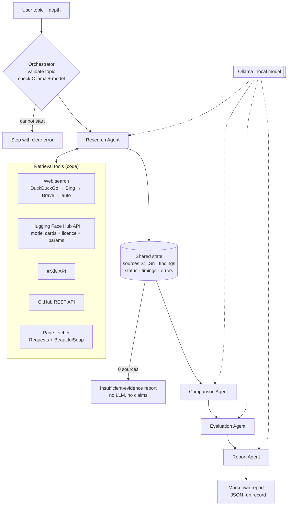

# Multi-Agent AI Research Assistant

A proof-of-concept **AI research team**: four specialised agents, coordinated by a LangGraph
workflow, investigate a technical topic and produce a structured, cited Markdown report.
All LLM inference runs **locally through Ollama**: no paid APIs, no API keys required.

> Example query: *"Research the latest open-source multimodal models suitable for on-premise
> deployment. Compare their capabilities, benchmarks, hardware requirements, licensing and limitations."*
> → see the generated example in [`outputs/example_report.md`](outputs/example_report.md).

---

## 1. What it does

| Agent | Responsibility | Output (Pydantic schema) |
|---|---|---|
| **Research Agent** | Plans search queries; searches the web (DuckDuckGo + free fallbacks), Hugging Face model cards (Hub API), arXiv and GitHub; fetches pages; extracts findings per source | `ResearchOutput`: findings with source ID, title, URL, type, date, summary, key findings, limitations |
| **Comparison Agent** | Selects the models, gathers per-model evidence, fills one table row per model (modalities, parameters, context window, deployment, hardware, licence), explains differences | `ComparisonOutput`: comparison table + key differences |
| **Evaluation Agent** | Extracts reported benchmark scores (verified against source text), assesses on-prem suitability, computes labelled memory estimates, flags missing evidence | `EvaluationOutput`: verified benchmarks, assessments, memory estimates, missing evidence |
| **Report Agent** | Consolidates everything into a 10-section technical report with references | `ReportOutput`: Markdown + citation audit |

## 2. Architecture



* **Fixed, loop-free sequence.** The only branches are "cannot start" and "no sources".
  Comparison and Evaluation are *logically* parallel (both consume only the Research
  output) but run sequentially, because one local model on a CPU would queue the requests anyway.
* **Shared state** ([orchestration/state.py](orchestration/state.py)) is a `TypedDict`. Each node
  returns only the keys it changed; *reducers* merge `agent_status`, `timings` and `errors`
  so agents never overwrite each other's bookkeeping.
* **Live status**: nodes emit events through LangGraph's `get_stream_writer()`; the UI
  consumes `graph.stream(..., stream_mode=["custom", "values"])`, so the agent cards show
  real transitions (Pending → Running → Completed / Failed / Skipped).

### Division of labour: code vs. LLM

| Step | Done by | Why |
|---|---|---|
| Choosing search queries, reading sources, filling table rows, writing prose | **LLM** | needs language understanding |
| Calling tools, URLs, titles, dates, citation IDs | **Code** | must be exact; a 2–4B model is unreliable at tool calling |
| Picking the most informative passages of each page | **Code** (keyword + evidence-signal scoring) | page starts are menus and intros |
| Which sources support each model row | **Code** (which findings mention the model) | the LLM never chooses its own citations |
| Licence / parameter count from model cards | **Code** (Hugging Face & GitHub API metadata) | more reliable than LLM copying; origin labelled |
| Licence category (OSI open source vs open weights) | **Code** (rules over the licence text) | never "upgrade" open weights to open source |
| Benchmark verification | **Code** | a score is kept only if it literally appears in the cited source |
| Memory estimates | **Code** (params × bytes/param × 1.2) | arithmetic, labelled *Estimate* |
| Tables, methodology, references | **Code** | generated from structured state, always consistent |

### Why the Comparison Agent works in small steps

The first live runs asked a 2B model to read every finding and produce the whole table in one
call. It returned **an empty table**. Splitting the job fixed it:

1. **Select** (LLM): which candidate names are AI models? Code rejects any name not in the research.
2. **Evidence** (code): collect only the finding lines about each model (+ its own model card).
3. **Row** (LLM, one small call per model): fill the row from that evidence only.
4. **Enrich** (code): fill gaps from API metadata, reject non-licences (e.g. a price), classify licence.
5. **Differences** (LLM): written from the finished table; code attaches the citations of the
   models each sentence names and drops sentences that name none.

## 3. How hallucinations are contained

1. **Citation registry.** Retrieval tools create `Source` objects (real URL/title/date) and the
   Research Agent numbers them `S1..Sn`. The LLM only ever writes IDs like `[S3]`.
2. **Invalid citations are removed.** Any `[S#]` not in the registry is stripped
   ([utils/citations.py](utils/citations.py)); comparison rows with no valid source are dropped.
3. **References are built by code** from the registry, so every URL in the report was actually retrieved.
4. **Benchmark verification.** A reported score survives only if that number *and* the
   benchmark name appear in the cited source's text; otherwise it is excluded and counted
   in the report. The app never runs benchmarks and says so explicitly.
5. **Attribution check on prose.** If a narrative sentence names a model and cites sources, the
   cited sources must actually mention that model; otherwise the sentence is removed and counted
   in the report. (Found live: *"Kimi K3.1-Pro is best for OCR [S2]"*, while S2 said that about Qwen3-VL.)
6. **Code-set citations in the comparison.** Which sources support a table row is decided by code
   (which findings mention the model); difference sentences get the citations of the models they name.
7. **Rule-based recommendations.** Besides the LLM's advice, code derives cited suggestions from the
   licence category and memory estimate (e.g. *OSI licence + ≤ 24 GB at 4-bit → single-GPU pilot candidate*).
8. **Honest failure.** If no relevant sources are found, the report states that research failed
   and makes no claims. If extraction fails for a source, its original snippet is shown
   and labelled as such. Failed sub-steps are reported as warnings, never hidden.
9. **Validated structured output.** Every LLM call uses Ollama's JSON-schema `format`
   and Pydantic validation, with one bounded retry.

## 4. Setup (Windows, macOS, Linux)

Requirements: Python 3.11+, [Ollama](https://ollama.com/download), internet access for retrieval.

```bash
cd multi-agent-research-assistant
python -m venv .venv
# Windows: .venv\Scripts\activate      macOS/Linux: source .venv/bin/activate
pip install -r requirements.txt

ollama pull qwen3.5:4b          # default model (~3.3 GB)
cp .env.example .env             # Windows: copy .env.example .env
```

### Choosing a model for your hardware

The default is `qwen3.5:4b` (set via `OLLAMA_MODEL`). Qwen3.5 small models ship with a
vision encoder (~0.9 GB) that Ollama loads even for text, so the 4B model needs roughly
**4.5 GB of free memory**. On low-memory machines:

| Free RAM | Suggested `OLLAMA_MODEL` |
|---|---|
| ≥ 6 GB | `qwen3.5:4b` (default) |
| 3–6 GB | `qwen3.5:2b` |

> On the 8 GB development laptop (Windows, VS Code and a browser open) `qwen3.5:4b` failed to load
> with an out-of-memory error, so the example report was produced with `qwen3.5:2b`.

```bash
ollama pull qwen3.5:2b
# then in .env:
OLLAMA_MODEL=qwen3.5:2b
```

If memory is insufficient the app shows: *"Not enough free memory to load '…'. Close other
applications, or use a smaller model…"*. The app **never** falls back to a paid API, and it
refuses Ollama *cloud* models (`*-cloud`) because inference must stay local.

Optional: set `GITHUB_TOKEN` in `.env` to raise the GitHub search rate limit (never logged or displayed).

## 5. Running

**Web UI**
```bash
streamlit run app.py
```
Enter a topic, choose **Basic** or **Detailed**, press **Start Research**. Results appear in four
tabs (Research Findings · Model Comparison · Evaluation · Final Report) with a Markdown download.

**Next.js web app** (the behind-the-scenes page) needs two terminals:
```bash
# 1. API server: runs the same LangGraph workflow and streams events (FastAPI + Server-Sent Events)
python -m uvicorn api.server:app --port 8000

# 2. Web app (Node.js 20+)
cd web
npm install
npm run build && npx next start -p 3000      # or: npm run dev
```
Open http://localhost:3000. It is a single page that shows the run **behind the scenes**: the
queries the model writes, every source each API returns, each source being read (and the facts kept),
citation IDs being assigned, table rows filling in, benchmark checks, removed sentences, and the
final report. Tap any line to see what it does and whether the model, plain code or an API did it.

* **Replay** (works anywhere, including the deployed site): plays back a real recorded run
  (`web/public/recorded-run.json`) with its real timings, sped up 10–100×.
* **Live** (only offered when the page runs on localhost and the API is up): streams a new run.

Every agent reports structured progress events (`progress("…", step="read_done", facts=[…])`), and
`run_workflow` records them with time offsets in the saved run, so a run can be replayed exactly.
To refresh the replay with a newer run:
```bash
python -m orchestration.workflow                         # records outputs/run_<timestamp>.json
python scripts/export_replay.py outputs/run_<timestamp>.json
```

**Command line** (same workflow, prints live events):
```bash
python -m orchestration.workflow "your topic here" basic
```

Every run is saved to `outputs/` as `report_<timestamp>.md` plus `run_<timestamp>.json`
(the full structured state: sources, findings, comparison, evaluation, statuses, timings).

**Expect it to be slow on CPU**: each source is read by the local model. See the timing
figures for the example run in [section 9](#9-example-run).

## 6. Tests

```bash
python -m pytest
```
All tests are offline: Ollama and every network call are mocked (`tests/fakes.py`).

| Test file | Covers |
|---|---|
| `test_schemas.py` | Pydantic validation, URL validation, research finding validation |
| `test_ollama_client.py` | structured output parsing, malformed output + retry, missing model, server down, out-of-memory, cloud-model refusal |
| `test_retrieval.py` | arXiv / GitHub / Hugging Face / web parsing, rate limits, offline, robots.txt, backend fallback chain |
| `test_cache.py` | cache round trip, expiry, empty results never cached |
| `test_research_agent.py` | one failed tool doesn't stop research, de-duplication, query relaxation, honest extraction fallback |
| `test_comparison_agent.py` | invented model names ignored, per-model evidence, code-set citations, metadata enrichment, failed steps reported |
| `test_evaluation_agent.py` | fabricated benchmark numbers rejected, unsupported assessments downgraded |
| `test_report_agent.py` | 10 sections in order, references = real URLs, uses all three agent outputs, fallback |
| `test_citations.py` | citation consistency, licence classification |
| `test_workflow.py` | execution order, shared-state updates, live status events, abort paths, failure isolation |
| `test_app.py` | page renders; Start disabled when Ollama is down; full results (4 tabs, metrics, download) render from the real example run |
| `test_api.py` | API health, example endpoint, SSE event order, crash reported as error event, validation, one run at a time |

Latest results (139 passed): [`docs/test_results.txt`](docs/test_results.txt).

## 7. Project structure

```
multi-agent-research-assistant/
├── app.py                     Streamlit UI
├── api/server.py              FastAPI: /api/health, /api/example, /api/research/stream (SSE)
├── scripts/export_replay.py   saved run -> web/public/recorded-run.json
├── web/                       Next.js 16 + Tailwind v4 + Motion frontend (one page)
│   ├── public/recorded-run.json   the real run the deployed site replays
│   └── src/
│       ├── app/page.tsx       the behind-the-scenes flow
│       ├── components/flow/   stage, row (one per step kind) and report views
│       └── lib/               flow.ts (events -> steps + explanations), use-flow-run.ts (replay / live)
├── config.py                  all settings (env / .env)
├── agents/                    one file per agent, each with its own SYSTEM_PROMPT
│   ├── research_agent.py
│   ├── comparison_agent.py
│   ├── evaluation_agent.py
│   └── report_agent.py
├── orchestration/
│   ├── state.py               shared TypedDict state + reducers
│   └── workflow.py            LangGraph graph, node wrapper, CLI
├── services/
│   ├── ollama_client.py       local LLM client (REST, JSON schema, validation, errors)
│   ├── web_search.py          DuckDuckGo via ddgs (+ free fallback engines)
│   ├── huggingface_search.py  Hugging Face Hub API: model cards, licence, parameter count
│   ├── arxiv_search.py        arXiv Atom API
│   ├── github_search.py       GitHub REST search + README
│   ├── document_fetcher.py    robots-aware page fetch + HTML → text
│   ├── cache.py               JSON file cache (TTL)
│   └── errors.py              RetrievalError
├── schemas/                   Pydantic models per agent
├── utils/                     citations.py (registry/audit), evidence.py (per-model evidence), helpers.py
├── tests/                     offline test suite
├── docs/PROJECT_BRIEF.md      original brief
└── outputs/                   generated reports + JSON run records
```

Deviations from the suggested structure: `config.py` (single place for settings),
`services/cache.py` and `services/errors.py` (shared by all tools), `services/huggingface_search.py`
(official model cards; the brief asks for model cards "where possible"), `utils/evidence.py`
(per-model evidence shared by Comparison and Evaluation), `tests/fakes.py` (test doubles).

## 8. Error handling

| Situation | Behaviour |
|---|---|
| Ollama not running | UI shows the error and disables Start; orchestrator aborts before any agent runs |
| Model not downloaded | message with the exact `ollama pull …` command |
| Not enough memory | actionable message suggesting a smaller model |
| Invalid topic (too short/long, no words) | rejected by the orchestrator |
| Internet down / one tool fails / rate limit | recorded per tool; other tools continue |
| Webpage fetch fails or blocked by robots.txt | search snippet used, flagged in the finding's limitations |
| No sources at all | insufficient-evidence report; Comparison/Evaluation skipped |
| Malformed LLM output | one retry with the validation error; then a labelled fallback (search plan → keyword plan, extraction → snippet, report narrative → code-only sections) |
| Invalid / missing citations | stripped and counted; citation audit shown in the UI |
| Agent crash | status = Failed, error recorded, remaining agents continue where possible |

## 9. Example run

See [`outputs/example_report.md`](outputs/example_report.md) and the full structured record in
[`outputs/example_run.json`](outputs/example_run.json).

**Query:** *"Research the latest open-source multimodal models suitable for on-premise deployment.
Compare their capabilities, benchmarks, hardware requirements, licensing and limitations."* Run at depth **Basic** with
model `qwen3.5:2b` on a Windows laptop (i5-1155G7, 8 GB RAM, CPU only).

The same run is what the website replays (`web/public/recorded-run.json`, 59 recorded events).

| Agent | Time | Output |
|---|---|---|
| Research | 519 s | 8 sources (2 web, 2 Hugging Face model cards, 2 arXiv, 2 GitHub), all 8 judged relevant |
| Comparison | 199 s | 4 models compared: Kimi K3.1-Pro, Qwen3.8-27B, ShowUI, open-pi-zero |
| Evaluation | 175 s | 0 verified benchmarks (none found in retrieved text), 2 memory estimates |
| Report | 176 s | 10 sections, 8 sources cited, 0 unknown citations |
| **Total** | **1,073 s** | 0 errors |

**What it got right:** every reference is a retrieved URL; licences and parameter counts come from the
Hugging Face / GitHub APIs with their source cited; every key-difference sentence cites exactly the sources
of the models it names (set by code); Qwen3.8-27B (27.78B, Apache-2.0) comes out as a single-GPU pilot
candidate at ~16.7 GB (4-bit, estimate), while Kimi K3.1-Pro (2.78T parameters, ~1.7 TB at 4-bit) is clearly
not an on-prem option; the report says plainly that no benchmark could be verified.

**Known flaws in this example (reviewed by hand and left in on purpose):**
* *"Kimi K3.1-Pro is the largest model … at 27.8 trillion parameters"*: the 2B model's arithmetic
  (2,780B is 2.78 trillion). The table and memory estimate, which come from code, are correct.
* open-pi-zero's context cell reads *"Block-wise causal masking"*: the model put an architecture detail in
  the wrong field. Code can reject non-answers ("not stated …") and non-licences (prices), but not every
  misplaced fact.
* The H100 hardware mentioned for open-pi-zero comes from its training instructions, not inference needs.

### What live testing changed (9 full runs)

Unit tests with a fake LLM passed from the start; the real model and real internet exposed problems
the mocks never could. Each fix below has a regression test named after the live failure.

| Run | Observed | Fix |
|---|---|---|
| 1 | Model wrote queries like `[multimodal model] [on-premise]`; GitHub returned 0; arXiv matched "premise"; 0 findings yet a "normal" report | query cleaning, generic-word removal + bounded relaxation, "0 findings → insufficient-evidence report" |
| 2 | Best articles dropped as irrelevant: the model saw only the page's menu/intro; model-card search returned GPT-2 | best-passage selection, HF Hub API sorted by trending, task guard for multimodal topics |
| 3 | Empty comparison table from one big prompt | Comparison split into select → evidence → one row per model → differences |
| 4–5 | Differences step failed silently; empty "no results" cached for 24 h; only Bing answered | warnings surfaced, never cache empty results, fixed engine fallback chain |
| 6 | "Kimi K3" inherited Kimi K3.1-Pro's 2.78T parameters | version-aware name matching |
| 7 | Architecture components picked as "models"; a price in the licence column; prose misattributed a capability | own-card models always compared, licence sanity check, attribution check |
| 8 | Attribution check removed a correct sentence ("PaliGemma VLM") | strict for versioned names, whole-word match for descriptive names |
| tests | UI test: status cards stacked instead of updating | `st.empty()` placeholders |

## 10. Limitations

Observed during live end-to-end runs with `qwen3.5:2b` on a CPU-only laptop:

* **Small local model reasoning.** A 2B model extracts facts reasonably but reasons poorly about
  them. For example, it once wrote that a 160K context was larger than a 1M context. The design limits the
  damage (code owns citations, numbers verification, licences, tables), but **narrative sentences can
  still contain reasoning errors. Verify critical statements in the cited sources.**
* **Results vary between runs.** Search engines return different pages, and the model's choices
  differ slightly, so two runs of the same topic produce different tables.
* **Free web search is fragile.** Free engines often return nothing to automated clients (at one point
  only Bing answered). The tool tries a fixed chain of engines and records which one answered; if all
  fail, research continues with the other tools and the report says so.
* **The attribution check is narrow.** It confirms that cited sources mention the models a sentence
  names; it cannot verify every claim inside the sentence (see the "ideal for OCR" example above).
* **Benchmark evidence is rare in retrieved text.** Model cards put scores in images or long tables
  beyond the passages the model reads, so runs often report *"no benchmark scores could be verified"*.
  That is honest, but thin. Verification is lexical: it confirms the number and benchmark name appear in the
  source, not that they belong together.
* **Shallow retrieval by design.** ~2–4 sources per category; no PDF parsing (arXiv abstracts only);
  JavaScript-heavy pages yield little text.
* **Licence classification is rule-based** and conservative; unusual names (e.g. Hugging Face's
  `other`) become "Unknown" rather than guessed.
* **Memory estimates are arithmetic**, not measurements: weights only, no KV cache or vision encoder.
* **CPU speed.** A Basic run takes ~9–13 minutes on a 4-core laptop CPU with the 2B model.
* **Dates** are publication dates for arXiv, creation dates for Hugging Face, last-push dates for
  GitHub and page metadata for websites (often missing).

## 11. Possible improvements

* Use a larger local model (4B–8B) on a machine with more RAM or a GPU. The pipeline is unchanged and
  only `OLLAMA_MODEL` differs; quality of reasoning and narrative should improve markedly.
* Run Comparison and Evaluation in parallel when a GPU / multiple model instances are available.
* Embedding-based passage selection and claim-level verification of narrative sentences against source text.
* Parse benchmark tables from model-card Markdown, and PDF parsing of arXiv papers.
* A reviewer step that checks the report against the evidence (bounded to one pass).
* Persist runs in SQLite and allow comparing reports over time.
* Optional benchmark execution on a small local evaluation set, kept clearly separate from reported scores.
